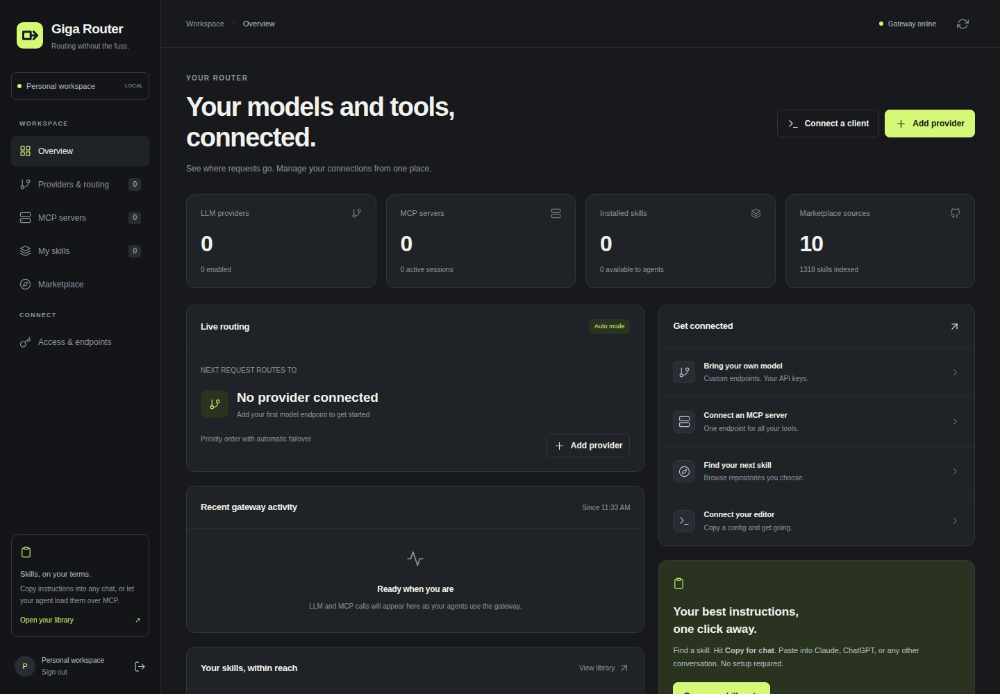
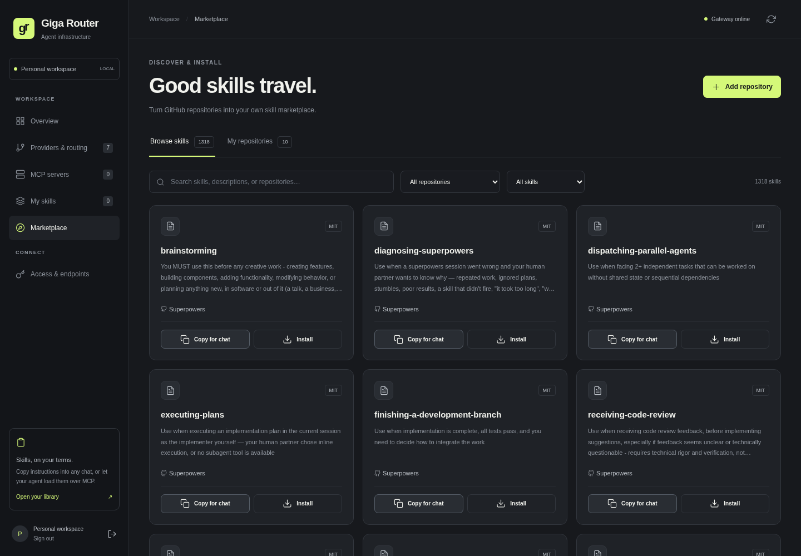
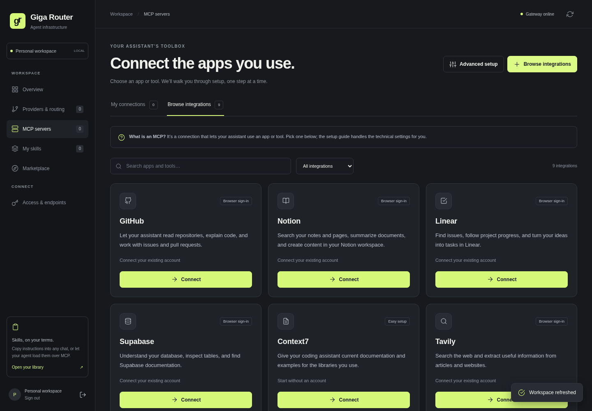

<div align="center">


# Giga Router

### Routing without the fuss.

A no-fuss router for your models, tools, and skills. Connect your providers and
apps once, then keep using the editor or assistant you already know. Run it on
your own machine, choose a model, and get on with your work.

Giga Router handles OpenAI and Anthropic requests, streaming, tool calls, and
fallbacks. MCP connections and reusable skills live in the same dashboard.

[](https://github.com/DeadIndian/giga-router/actions/workflows/ci.yml)
[](https://nodejs.org/)
[](package.json)

[Getting started](#installation) ·
[Implementation guide](docs/giga-router.md) ·
[Connect apps and tools](docs/mcp-integrations.md) ·
[Free API providers](docs/free-providers.md) ·
[Update the live server](docs/operations.md) ·
[Report an issue](https://github.com/DeadIndian/giga-router/issues)



</div>

## Table of contents

- [Features](#features)
- [Screenshots](#screenshots)
- [Installation](#installation)
- [Configuration](#configuration)
- [Skills and marketplace](#skills-and-marketplace)
- [Unified MCP gateway](#unified-mcp-gateway)
- [Direct model selection](#direct-model-selection)
- [Claude Code](#claude-code)
- [Tests](#tests)
- [Project structure](#project-structure)
- [Contributing](#contributing)
- [License](#license)
- [Maintainer](#maintainer)

## Features

- **Overview:** current routing, configuration counts, and recent gateway calls.
- **Providers & routing:** custom OpenAI/Anthropic-compatible endpoints, custom
  headers and User-Agent settings, fallback priorities, and routing schedules.
- **Free APIs:** documented free-provider presets, direct API-key links, labeled
  accounts with separate credentials, searchable model lists from FreeLLMAPI and
  official catalogs, and previewed FreeLLMAPI/OmniRoute key imports.
- **MCP servers:** Streamable HTTP, legacy SSE, or stdio servers exposed through
  one authenticated `/mcp` endpoint, with tool discovery and enable/disable.
- **My skills:** create/edit skills, install from GitHub, toggle agent
  availability, download bundles, and **Copy for chat** in one click.
- **Marketplace:** GitHub repository sources, searchable `SKILL.md` cards,
  previews, installs, refreshes, and updates.
- **Access & endpoints:** client configurations and scoped, revocable API keys,
  optionally restricted to selected MCP servers.

## Screenshots

<details>
<summary>Find a skill or connect an app</summary>

Browse skill catalogs, read a preview, and copy or install what you need.



Choose an app or local tool and follow its connection guide.



</details>

## Installation

### Docker Compose

Requires Docker with the Compose plugin.

```bash
git clone https://github.com/DeadIndian/giga-router.git
cd giga-router
cp .env.example .env
```

Edit `.env` and set `user`, `password`, and a random `ROUTER_KEY` before starting.
Generate a gateway key with:

```bash
docker run --rm node:22-alpine node -e "console.log(require('node:crypto').randomBytes(32).toString('hex'))"
```

Then start the router:

```bash
docker compose up -d --build
```

On a Linux host with systemd, run `sudo ./scripts/deploy-local.sh` to enable Docker
at boot, rebuild the app, wait for health checks, and verify saved configuration.

For ongoing updates, follow [docs/operations.md](docs/operations.md): pull the
tested commit, then run the helper. Port **3002 is production**; use temporary
data and another port for development. Pushing code alone does not redeploy it.
The container restarts automatically unless you explicitly stop it.

Open **http://127.0.0.1:3002** and sign in with the username and password you
configured. Add your first provider in **Providers & routing**. **Access &
endpoints** has connection URLs and gateway keys for your clients.

The Docker volume preserves configuration, skills, and marketplace indexes
across rebuilds. Compose keeps the existing `llmrouter` project and service names
and uses `llmrouter_llmrouter-data`, preserving existing installs after the rename.
Set `GIGA_ROUTER_DATA_VOLUME` in `.env` to use a different volume.

### Local development

Requires Node.js 22 or later and npm.

```bash
git clone https://github.com/DeadIndian/giga-router.git
cd giga-router
npm ci
cp .env.example .env
```

Set your credentials in `.env`, then run:

```bash
node --env-file=.env server.js
```

This uses `./data` unless `DATA_DIR` is set; it does not automatically use the
Docker volume. `npm start` also runs `server.js`, but expects environment variables
to be supplied by your shell or process manager.

## Configuration

See [.env.example](.env.example) for the starter configuration.

| Variable | Purpose | Default |
| --- | --- | --- |
| `user` | Dashboard username; `ADMIN_USER` is also accepted | `admin` |
| `password` | Dashboard password; `ADMIN_PASSWORD` is also accepted | Set your own in `.env` |
| `ROUTER_KEY` | Gateway access key for LLM and MCP clients | Set a random key in `.env` |
| `PORT` | HTTP listen port; keep `3002` with the bundled Compose port mapping | `3002` |
| `HOST_BIND` | Host-side Docker bind address; use `0.0.0.0` for LAN access | `127.0.0.1` |
| `DATA_DIR` | Persistent data directory | `./data` locally; `/app/data` in Compose |
| `GITHUB_TOKEN` | Optional token for private sources and higher GitHub API limits | Unset |
| `GIGA_ROUTER_DEFAULT_MARKETPLACES` | Set to `false` to skip built-in catalog seeding | Enabled |
| `GIGA_ROUTER_PUBLIC_URL` | Public HTTPS origin for hosted OAuth callbacks | Browser request origin |

### Dashboard password

This is a single-user dashboard. Sign in with the username and initial password
from `.env`, then open **Access & endpoints → Change password**. Enter your
current password and confirm a new password with at least 8 characters.

The new password is saved as a salted scrypt hash in `DATA_DIR/admin-auth.json`
and survives container rebuilds and restarts. It takes precedence over the initial
password in `.env`. Other dashboard sessions are signed out; your current session
stays signed in. Gateway API keys are separate and continue working.

Back up the complete data volume to keep account settings and provider connections.
To recover a forgotten dashboard password, stop the router, remove only
`admin-auth.json` from its data volume, and start it with a new initial password
in `.env`.

`GITHUB_TOKEN` is used only for GitHub requests and never returned by the
dashboard. `HOST_BIND` controls Docker's published port, not the native Node.js
listener. Back up the complete data directory or Docker volume, including
`mcp-credentials.key`, to preserve encrypted integration credentials.

## Skills and marketplace

Self-hosted installs include **10 removable marketplaces with 1,318 skills**:

| Built-in source | Collection |
| --- | --- |
| [Superpowers](https://github.com/obra/superpowers) | Planning, debugging, testing, reviews, and shipping |
| [Microsoft Skills](https://github.com/microsoft/skills) | Azure, AI applications, SDKs, and development tools |
| [GitHub Awesome Copilot](https://github.com/github/awesome-copilot) | Community engineering and automation skills |
| [Expo Skills](https://github.com/expo/skills) | Expo, React Native, and EAS workflows |
| [Supabase Agent Skills](https://github.com/supabase/agent-skills) | Supabase and PostgreSQL best practices |
| [Everything Claude Code](https://github.com/affaan-m/ECC) | Coding and agent workflows |
| [wshobson Agents](https://github.com/wshobson/agents) | Specialist engineering skills |
| [Marketing Skills](https://github.com/coreyhaines31/marketingskills) | Marketing, SEO, analytics, and growth |
| [Claude Skills · Engineering](https://github.com/alirezarezvani/claude-skills) | Engineering and architecture |
| [n8n Skills](https://github.com/czlonkowski/n8n-skills) | n8n workflows, expressions, and code nodes |

The catalogs and license/provenance metadata ship as local, pinned snapshots.
**Browse, Preview, and Copy for chat work immediately**, even offline; installing
a skill still downloads its full directory from GitHub. No skills are installed
automatically. Catalog counts/commits are listed in
[marketplaces/builtin/manifest.json](marketplaces/builtin/manifest.json).

Remove any built-in under **Marketplace → My repositories**. The removal is
remembered in your data volume and survives restarts/upgrades. Installed skills
remain in your library. **Restore built-in sources** is an explicit action that
brings removed sources back. Existing custom sources, names, and refreshed
indexes are preserved during startup.

For an empty-by-default installation, set
`GIGA_ROUTER_DEFAULT_MARKETPLACES=false` in `.env`. This prevents seeding; it does
not delete sources already in your data volume. Maintainers can regenerate the
packaged snapshots with `GITHUB_TOKEN=... npm run update:marketplaces`; this is
never run by the Docker build or application startup.

To add your own source:

1. Open **Marketplace → Add repository**.
2. Paste `https://github.com/obra/superpowers`, `owner/repo`, a directory URL,
   or a link to a `SKILL.md`. Branch/commit and path overrides can scope a large
   repository or select a branch containing `/`.
3. Browse searchable cards. **Preview** reads the instructions;
   **Copy for chat** works even before installing.
4. **Install** downloads the skill directory, including references, scripts,
   assets, and license/provenance information, from the indexed commit.
5. Installed skills appear in **My skills**. **Copy for chat** copies the
   instructions without YAML frontmatter; **Copy SKILL.md** copies the raw
   file. Clipboard failures produce an error rather than claiming success.
6. Refresh a source to discover updates. Bundle hashes include supporting
   files, so reference/script changes also show as updates. Updating a locally
   edited skill asks before replacing it. Removing a source keeps installed
   copies; deleting a skill removes its local bundle.

Files persist under `DATA_DIR/skills/<id>/files/`. **Download** produces a ZIP
whose top-level skill folder can be placed in an agent's skills directory.
The gateway does not execute installed skill scripts.

Source indexes are cached under `DATA_DIR/marketplace/`. GitHub API requests
resolve the commit and tree; file content uses pinned raw GitHub URLs. Indexes
support up to 1,000 skills per source; `SKILL.md` up to 512 KiB; installed bundles
up to 100 files/8 MiB.

## Unified MCP gateway

For easy setup, open **MCP servers → Browse integrations**. Nine app/tool presets
include GitHub, Notion, Linear, Supabase, Context7, Tavily, Files, Memory, and
Thinking. Every preset has a beginner-friendly **Choose → Connect → Ready** guide,
account/token instructions, automatic connection testing, and an example prompt.
Local tools are included with the app; Files offers a shared-folder uploader.

Browser sign-in, refresh, reconnect, and disconnect are supported for the hosted
OAuth integrations. GitHub's guide includes one-time app registration and a
personal-access-token alternative. For hosted callback URLs set
`GIGA_ROUTER_PUBLIC_URL=https://router.example.com`. See the full
[step-by-step integration guide](docs/mcp-integrations.md).

Add each backend on **MCP servers**. An auth-less HTTP server needs only its URL;
a protected backend can use stored headers. Endpoints can be localhost,
Docker services, private-network hosts, or public servers reachable by the
gateway. Inside Docker, `host.docker.internal` reaches your host machine.
Stdio commands execute inside the gateway container, so their executables and
files must exist there.

Clients connect to the router's `/mcp` with
`Authorization: Bearer <gateway-key>` (or `X-Gateway-Key`). The original
`ROUTER_KEY` works on both LLM and MCP routes; the dashboard also creates keys
scoped to `llm`, `mcp`, and selected MCP servers. Revoking a key closes its MCP
sessions.

```json
{
  "mcpServers": {
    "giga-router": {
      "url": "http://127.0.0.1:3002/mcp",
      "headers": { "Authorization": "Bearer YOUR_GATEWAY_KEY" }
    }
  }
}
```

- Tools/prompts: `search__query`, `files__read`.
- Resources: `giga://<server>/<original-uri>`.
- Skills: `giga__skill` tool, `skill__<id>` prompts, and
  `skill://<id>/SKILL.md` resources.
- Each client owns separate gateway/backend sessions. Idle sessions expire
  after 30 minutes. Disabled/removed servers cannot be called on old sessions.
- Registry changes send MCP list-change notifications to compatible clients.
- Backend sampling, elicitation, and resource subscriptions are not forwarded.
  Agent-to-router authentication stays API-key based; curated provider
  connections can use browser OAuth or their own service tokens.

For internet access, point an HTTPS reverse proxy or tunnel at port 3002. Only
the gateway endpoint needs public exposure; its backend URLs must be reachable
from the gateway host. Dashboard cookies are secure when HTTPS is indicated by
the deployment proxy.

## Direct model selection

The normal model field uses your active routing/schedule configuration.
`GET /v1/models` lists explicit aliases such as `my-provider/model-id`.
Using an alias selects that provider for the call without changing your active
provider or fallback order. `X-Giga-Provider: <provider-id-or-name>` also pins a
request. Both Anthropic and OpenAI client formats work.

Provider keys and custom headers are masked in API responses. On edit, an
omitted field or `***` preserves its saved value. An empty key supports an
auth-less local model. `endpointPath` appends a custom path to the base URL;
otherwise the original `/v1/messages` or `/v1/chat/completions` convention applies.

Config writes use atomic rename and owner-only permissions. The router caches
config between changes and detects external edits. New API keys are stored as
hashes. Existing provider credentials remain in the configuration volume and
are not sent to client APIs. Sessions/recent activity are memory-only; restart
requires dashboard login again.

New MCP integration credentials are AES-256-GCM encrypted under
`DATA_DIR/mcp-credentials/`; back up `DATA_DIR/mcp-credentials.key` with that volume.
OAuth refresh tokens and app registrations survive restarts. Short-lived
authorization state/verifiers stay in memory and expire after ten minutes.

## Claude Code

Claude Code sends Anthropic-format requests to `/v1/messages`. AgentRouter's
OpenAI-compatible configuration uses `/v1/chat/completions`. Point Claude Code at
this router, not directly at the AgentRouter URL; the router translates between
the two protocols, including streaming and tool-use conversations.

Configure the AgentRouter provider in the web UI:

| Setting | Value |
| --- | --- |
| Type | OpenAI |
| Base URL | `https://agentrouter.org/v1` |
| Default model | `gpt-6-astra` |
| API key | Your AgentRouter API key |
| Disable reasoning effort with tools | Enabled for gateways that reject reasoning with tools |

Leave any working provider-specific User-Agent or custom header settings intact.
If AgentRouter reports that function tools do not support `reasoning_effort`,
enable the compatibility option above. It sends `reasoning_effort: "none"` when
a request combines tools and an explicit reasoning effort.

Choose AgentRouter as the active provider in **manual** routing mode to use it
exclusively. Auto mode can select other providers or apply schedule overrides.
The selected provider's default model replaces ordinary model names requested by
the client. Explicit `provider/model` aliases select a provider for that call.

With `ROUTER_KEY` set to the access key in **Access & endpoints**, run:

```bash
export ANTHROPIC_BASE_URL="http://127.0.0.1:3002"
export ANTHROPIC_API_KEY="${ROUTER_KEY:?Set ROUTER_KEY to the router access key}"
unset ANTHROPIC_AUTH_TOKEN
claude --model gpt-6-astra
```

Use the router origin without `/v1` for `ANTHROPIC_BASE_URL`. The key Claude Code
sends must be the **router access key**, not the upstream AgentRouter key. Existing
Claude Code settings can override shell environment variables; check `/status`
if the URL or credential source is unexpected.

`tool_call` and `reasoning` in an OpenCode provider definition declare client
capabilities. They are not Claude Code configuration options. This proxy handles
text and function-tool conversion; it does not implement all Anthropic-only
features, such as server-hosted tools or signed thinking blocks. Token counting
is an explicitly marked character-based estimate, not an exact model tokenizer.
Routing non-Claude models through Claude Code is not officially supported by
Anthropic.

## Tests

```bash
npm test
npm run check
```

Tests cover translation, fragmented UTF-8/SSE, tool-call round trips, errors,
authentication, routing, provider health, marketplace install/update persistence,
license preservation, MCP aggregation, scoped keys, and session isolation.
HTTP tests use isolated temporary configuration and loopback mock upstreams.
They never call paid providers or change the running router's configuration.

## Project structure

```text
server.js              Express app, routing, protocol translation, and streaming
lib/                   Authentication, persistence, MCP, OAuth, and skills
public/                Self-hosted dashboard, styles, scripts, and icons
marketplaces/builtin/  Pinned skill catalogs and source manifest
scripts/               Release-time marketplace snapshot updater
fixtures/              Local MCP test backend
test.js, test-*.js      Translation and integration tests
docs/                  Implementation and app-connection guides
```

## Contributing

Issues and pull requests are welcome. Install dependencies with `npm ci`, make
your changes, and run `npm test` and `npm run check` before opening a pull request.
Include reproduction steps for bugs and explain the intended behavior for new
features. See [docs/giga-router.md](docs/giga-router.md) for implementation scope.

## License

A project license has not been selected. Dependencies and bundled marketplace
content retain their own licenses; see
[THIRD_PARTY_NOTICES.md](THIRD_PARTY_NOTICES.md) for their notices and provenance.

## Maintainer

[DeadIndian](https://github.com/DeadIndian)
